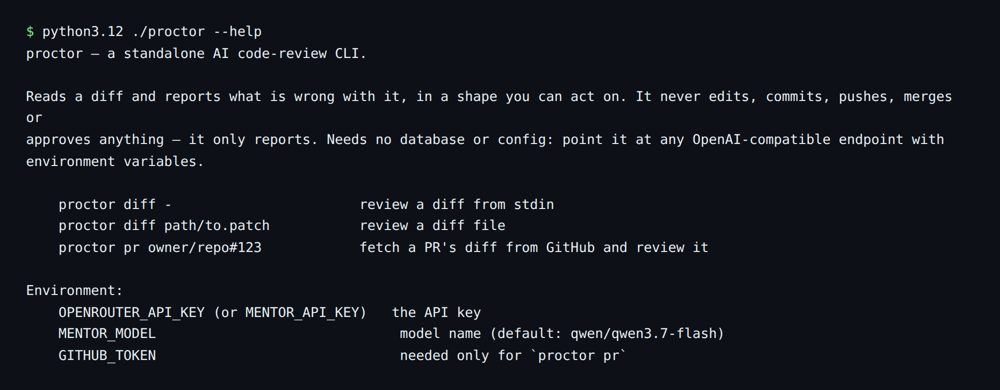
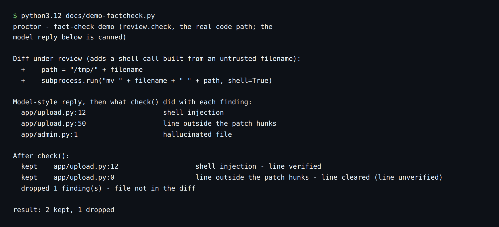
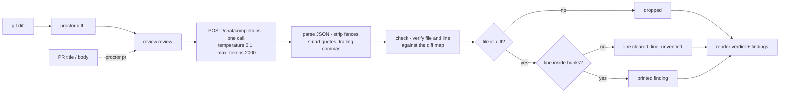

# proctor

**A standalone AI code reviewer you run from a terminal: point it at a git diff and it reports what is wrong, with every finding fact-checked against the diff.**



It only reports. It never edits, commits, pushes, merges or approves anything — a human still merges. `proctor` is the standalone review engine that was extracted from [warden](https://github.com/casareanderson/warden)'s PR reviewer.

 [](https://buymeacoffee.com/iamc_tech)

## What it does

- Reviews a git diff from stdin or a patch file, or fetches a GitHub PR by `owner/repo#N` and reviews it (`proctor` CLI, `diff` and `pr` commands).
- Returns one verdict — `approve`, `comment` or `changes` — with findings that each carry a severity, file, line, title and why.
- Fact-checks every finding against the diff before printing: a finding that names a file not in the diff is dropped, and a line outside that file's hunks is cleared and marked `line_unverified` (`review.check`).
- Works with any OpenAI-compatible endpoint — OpenRouter, a local Ollama, anything — configured with three environment variables.
- Reviews the diff only, for things that cause harm or surprise: injection, secrets in code or logs, unsafe shell/docker/path handling, broken authz, silent data loss, regressions and clear mistakes. Style and nitpicks are ignored unless they hide a bug.
- Parses model output defensively: markdown fences, smart quotes and trailing commas are stripped before the JSON is read.

## Screenshots / demo




## Quick start

Prerequisites: Python 3.12 or newer (the source uses f-string escapes that fail on 3.11 — see Status), `pip`, and `requests` (only needed for `proctor pr`).

```bash
git clone https://github.com/casareanderson/proctor.git
cd proctor
pip install requests
python3.12 ./proctor --help
```

Success looks like the usage text in the first screenshot above. Opt-in the message model: see Configuration and [docs/SETUP.md](docs/SETUP.md).

## Usage

```bash
# review the working-tree changes
git diff | python3.12 ./proctor diff -

# review a saved patch
python3.12 ./proctor diff path/to.patch

# review a GitHub PR (GITHUB_TOKEN lifts the unauthenticated rate limit)
GITHUB_TOKEN=ghp_... python3.12 ./proctor pr casareanderson/sieve#23

# every PR on a repo, on a timer
for n in $(gh pr list --json number --jq '.[].number'); do
  gh pr diff "$n" > "/tmp/pr-$n.patch"
  GITHUB_TOKEN=$GH_TOKEN ./proctor pr "owner/repo#$n"
done
```

Example output (the `render` format): the patch adds a shell call built from an untrusted filename.

```
proctor — changes
The patch adds a shell call built from an untrusted filename.

  🔴 [app/upload.py:41] shell injection — subprocess.run(f"...{filename}...", shell=True) with an untrusted filename
  🟡 [app/upload.py] missing size cap — the file is read into memory with no limit
```

The exit code is 0 after any successful run regardless of verdict; it only goes non-zero when the diff cannot be read or the model is unreachable. See [docs/EXAMPLES.md](docs/EXAMPLES.md) for a GitHub Actions recipe.

## Configuration

| Variable | Default | What it does |
|---|---|---|
| `MENTOR_URL` (or `OPENROUTER_URL`) | `https://openrouter.ai/api/v1` | endpoint base for `/chat/completions` |
| `MENTOR_MODEL` | `qwen/qwen3.7-flash` | the model name |
| `MENTOR_API_KEY` (or `OPENROUTER_API_KEY`) | — | the API key |
| `GITHUB_TOKEN` | — | GitHub API auth, only for `proctor pr` |

All read in [`review.py`](review.py) / the CLI; `docs/SETUP.md` has the full endpoint and model notes. Set the key and model, then run a command from Usage.

## How it works

`proctor` sends one request per review. The model gets a fixed system prompt that defines the scope and the JSON schema, plus the diff (with the PR title and description when reviewing a PR). The reply is parsed and then run through `check()`, which rebuilds a map of every file and hunk in the diff from the `diff --git` / `+++ b/` / `@@` lines and verifies each finding against it. Only findings that survive are printed.



Project structure:

```
proctor/
├── proctor            # CLI: diff / pr commands, console rendering
├── review.py          # system prompt, model call, JSON parsing, fact-check (check)
├── docs/
│   ├── EXAMPLES.md    # worked examples, GitHub Actions recipe
│   ├── SETUP.md       # endpoint, model, GitHub token setup
│   ├── screenshot-cli.png        # help output (2026-11-09)
│   ├── screenshot-factcheck.png  # fact-check demo (2026-11-09)
│   └── demo-factcheck.py         # reproduces the fact-check screenshot
└── LICENSE            # AGPL-3.0
```

## Status, limits and real results

- Runs on Python 3.12.3 (verified 2026-11-09: `proctor --help` prints usage and exits 2). It does **not** run on Python 3.11 — syntax error from f-string escapes at `proctor:33` and `review.py:108` (PEP 701 is 3.12+). This is a known issue, not a planned feature.
- End-to-end review against a live model has **not been measured** (no API key in the test environment, 2026-11-09). The CLI, parsing and fact-check paths were verified without a model (see Screenshots).
- It sees only the diff: code around the change, the ticket and intent are invisible. The diff is truncated at 24,000 characters (`MAX_DIFF`) and a PR body at 2,000 characters.
- The fact-check catches wrong files and lines, not a wrong judgement on a real line. Read the `why`, don't rubber-stamp it.
- It is advisory. Verdicts map to GitHub review events (`VERDICT_EVENT`) only if you wire them into your own bot; the CLI itself prints.

## Licence and credits

AGPL-3.0-or-later (see [LICENSE](LICENSE)). `proctor` was extracted from [warden](https://github.com/casareanderson/warden)'s PR reviewer; sibling tools in the same family: warden (server + console), sieve (vulnerability scanner), ephor (AI-agent exposure) and farrier (patch applier).
